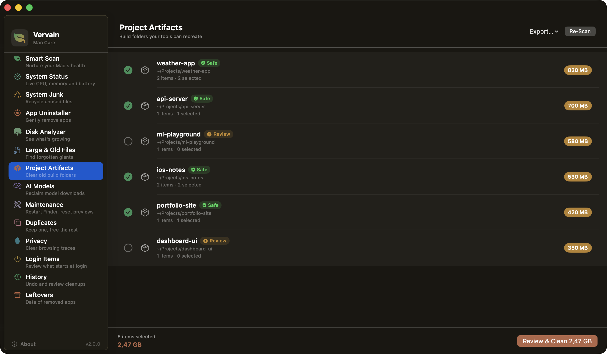
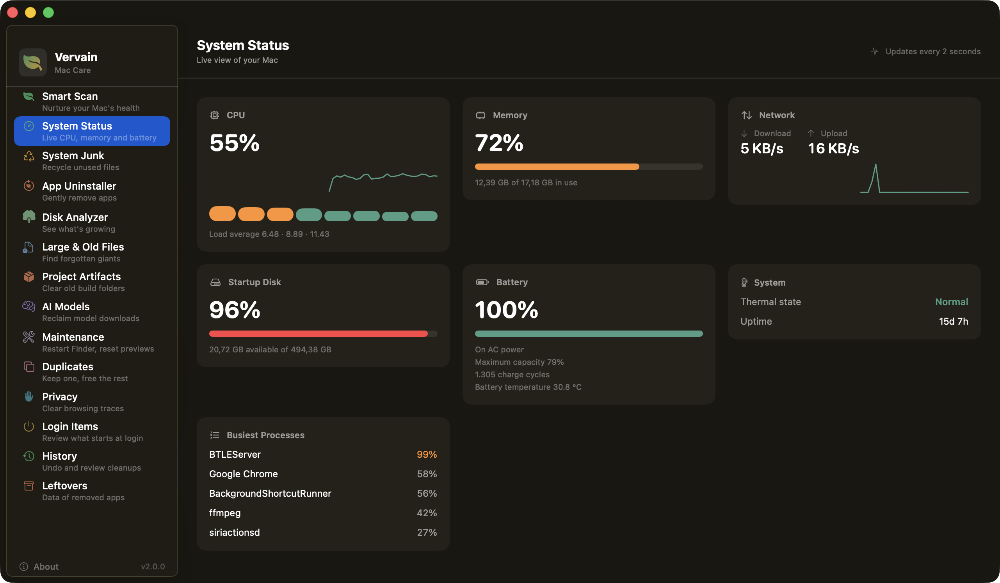

<p align="center">
  
</p>

<h1 align="center">Vervain</h1>

<p align="center">
  <strong>Free, open-source macOS cleaner that respects your files and your privacy.</strong>
</p>

<p align="center">
  <a href="https://vervain.app"></a>
  <a href="https://github.com/yakupbulbul/Vervain/releases/latest"></a>
  <a href="https://github.com/yakupbulbul/Vervain/blob/main/LICENSE"></a>
  
  
</p>

<br>

<p align="center">
  
</p>

<br>

## Why Vervain?

Every Mac cleaner I tried either wanted a subscription, phoned home with analytics, or auto-deleted files I didn't ask it to touch. Vervain does none of that. It moves things to Trash so you can undo, it shows you everything before acting, and it never talks to a server.

| | Vervain | CleanMyMac | OnyX |
|---|:---:|:---:|:---:|
| Price | **Free forever** | $40/year | Free |
| Open source | **Yes** | No | No |
| Analytics/tracking | **None** | Yes | None |
| Deletes to Trash (undoable) | **Yes** | No | No |
| App uninstaller with leftovers | **Yes** | Yes | No |
| Disk analyzer | **Yes** | Yes | No |
| Duplicate finder | **Yes** | Yes | No |
| Review before cleanup | **Always** | Partial | Partial |
| Multi-language | **6 languages** | Yes | No |

## Install

**Homebrew:**
```bash
brew install yakupbulbul/vervain/vervain
```

**Direct download:**

> [Download the latest Vervain DMG](https://github.com/yakupbulbul/Vervain/releases/latest), signed and notarized by Apple.

## Features

<table>
<tr>
<td width="50%">

### Smart Scan
Health score with a transparent breakdown. Every deduction is explained, and Vervain tells you what the score would be after you clean the safe items.

</td>
<td width="50%">

### System Junk
Finds caches, logs, leftover language files, old installers, and stale downloads. Downloads are never pre-selected. You pick what goes.

</td>
</tr>
<tr>
<td>

</td>
<td>

</td>
</tr>
<tr>
<td width="50%">

### App Uninstaller
Shows installed apps with leftover files tagged by confidence level (high, medium, low). Apple system apps are protected and can't be uninstalled.

</td>
<td width="50%">

### Disk Analyzer
Donut chart of what's eating your disk, with drill-down into folders and largest files list. Honest about folders it can't access.

</td>
</tr>
<tr>
<td>

</td>
<td>

</td>
</tr>
</table>

<table>
<tr>
<td width="50%">

### Project Artifacts
Old `node_modules`, `target`, `.build` and `Pods` folders, grouped by project. Only the ones git ignores, in projects you haven't touched for a week, start out selected.

</td>
<td width="50%">

### System Status
CPU, memory, disk, network and battery, live while the screen is open. It stops sampling when you leave it.

</td>
</tr>
<tr>
<td>

</td>
<td>

</td>
</tr>
</table>

### New in 2.0

2.0 is mostly about reaching the places other cleaners skip, with the same rules about review and Trash as before.

If you write code, there are a few new places to look. Project Artifacts finds `node_modules`, `target`, `.build`, `Pods`, virtual environments and other build folders and groups them by project. Only folders that git ignores, in projects you haven't touched for a week, start out selected. Everything else waits for you. AI Models lists what Hugging Face, LM Studio, Ollama, PyTorch, Whisper, Keras and GPT4All have downloaded. I left all of it unselected, because finding out you have to fetch a 20 GB model again is a bad surprise. The developer caches also grew: Gradle, Cargo, Maven, Go, JetBrains, pnpm, Xcode documentation and simulators.

System Status shows CPU, memory, disk, network, battery and thermal state live, plus the busiest processes. It only samples while the screen is open. Maintenance resets Quick Look previews and restarts Finder, the Dock or the menu bar. Anything that needs administrator rights (flushing DNS, rebuilding the Spotlight index, purging memory) shows up as a Terminal command you can copy. Vervain doesn't run those itself, and I'd rather keep it that way than ask for your password. Time Machine local snapshots are listed in Maintenance too, read-only, for the same reason.

Cleanups got easier to undo. Every one is recorded, so you can put items back from the done screen or from History. The review list has search, sorting, file type filters, an "only safe items" switch, Quick Look, Reveal in Finder and export to CSV or Markdown. A protected-path guard blocks system locations, files that changed since the scan are refused, and the Finder/AppleScript fallback is gone.

The rest of the list:

- Large & Old Files, with size and age thresholds you choose. Nothing is pre-selected.
- Duplicates, matched by size, partial hash and SHA-256. The oldest copy is always kept and never listed.
- Privacy, for Safari, Chrome, Firefox, Edge and Brave. Caches are pre-selected, history is for review, and cookies are never pre-selected.
- Login Items, to see third-party launch agents and daemons. You can remove your own through the normal review flow.
- Leftovers from apps you already removed, found by bundle identifier and never pre-selected.
- A smarter uninstaller that shows when you last opened an app, filters ones untouched for six months, takes a dragged `.app` and quits running apps first.
- A Disk Analyzer that can look at any folder or external disk, with accurate sizes below the depth limit.
- A menu bar monitor with a startup-disk gauge and a quick junk scan, a weekly reminder, a low-disk alert, an exclusion list for folders Vervain must never touch, Shortcuts actions and open at login.

## Languages

Vervain comes in 6 languages. You can switch anytime in **Settings** (⌘,):

🇬🇧 English · 🇫🇷 Français · 🇩🇪 Deutsch · 🇹🇷 Türkçe · 🇪🇸 Español · 🇨🇳 中文(简体)

Vervain automatically uses your Mac's system language, or you can choose a different one in the app.

## Three Promises

1. **Nothing gets permanently deleted.** Every cleanup moves items to the Trash. You can always restore from Trash.
2. **Nothing gets cleaned without your say-so.** Every module goes through a review → confirm → clean flow. Risky items are never pre-selected.
3. **Nothing leaves your Mac.** No analytics, no accounts, no background network calls. The only request Vervain ever makes is the optional **Check for Updates** button in Settings.

## Building from Source

You need macOS 15+, Xcode 16+, and Swift 6.

```bash
git clone https://github.com/yakupbulbul/Vervain.git
cd Vervain
open Vervain.xcodeproj
# ⌘R to run
```

### Full Disk Access

Vervain works without Full Disk Access. It skips protected folders and tells you what it couldn't reach. If you want a complete scan, go to **System Settings → Privacy & Security → Full Disk Access** and add Vervain. The app detects the change automatically.

## How It's Built

Swift 6 with strict concurrency. SwiftUI for the UI, actor-isolated services for file system work, `@Observable` view models on the main actor. The only deletion primitives in the entire codebase are `FileManager.trashItem` and `NSWorkspace.recycle` (both move items to the Trash), called from a single `CleanupService`, and everything else routes through it. There is no AppleScript. Vervain never goes through a shell either. The few system tools it starts (`qlmanage`, `killall`, `ps`, `tmutil`, and `git` to check what a project ignores) come from a fixed list with fixed arguments, and nothing you type or read from disk becomes part of a command.

The `CleanupCoordinator` owns the review flow state machine (idle → reviewing → confirming → executing → done) and is shared across all modules.

## Roadmap

- [x] Login items viewer
- [x] Large & old files scanner
- [x] Duplicate file finder
- [x] Privacy cleanup (browser caches, history, cookies)
- [x] Menu bar disk monitor
- [x] Memory view in the menu bar
- [ ] Maintenance tasks (they need shell access, which Vervain deliberately never uses)
- [ ] Toggle launch agents on and off (currently view and remove only)
- [x] Translations for the v2 screens (Turkish, German, Spanish, French, Chinese)

## Contributing

Pull requests are welcome. If you're adding a new cleanup module, all deletion must go through `CleanupService`. That is how the safety model works. Items need a risk level and a confidence level so the review UI can make good default selections.

Have a look at `CleanupSelectionPolicy` to understand which items get pre-selected and which don't.

## License

MIT. See [LICENSE](LICENSE).

---

<p align="center">
  <a href="https://vervain.app">Website</a> · <a href="https://github.com/yakupbulbul/Vervain/releases">Releases</a> · <a href="https://buymeacoffee.com/yakupbulbul">Buy Me a Coffee</a>
</p>
<p align="center">Made by <a href="https://github.com/yakupbulbul">Yakup Bulbul</a></p>
